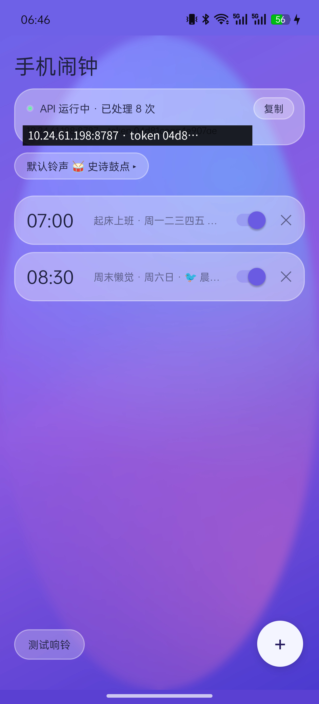
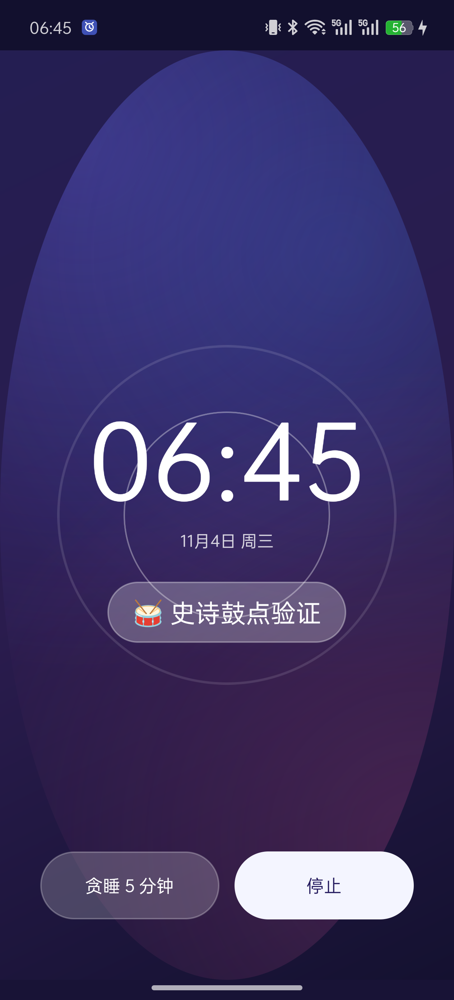

# 📱 phone-alarm —— agent 可远程控制的手机闹钟

自研 Android 闹钟 App + PC 侧 MCP server：让 AI agent（ZCode / Claude 等）通过 MCP 直接**创建、管理、触发**你手机上的真实闹钟——到点全屏响铃、锁屏可响、内置核爆级铃声。

```text
┌──────────┐  stdio / MCP  ┌──────────────────┐   HTTP :8787    ┌──────────────────────┐
│ AI agent │ ────────────► │ phone_alarm_mcp  │ ──────────────► │ Android App（常驻     │
│ (ZCode…) │               │ (FastMCP, PC 侧) │  Bearer token   │ 前台服务 + 内嵌 API)  │
└──────────┘               └──────────────────┘                 └──────────┬───────────┘
                                                                           │ AlarmManager.setAlarmClock
                                                                           ▼
                                                             ⏰ 精确闹钟 → 全屏响铃（锁屏可响）
```

> 全栈零第三方依赖：App 用 Java 直写（无 Gradle、无 androidx），PC 侧仅用 `mcp` 官方库。APK 仅 ~950KB。

## ✨ 功能

| | 功能 | 说明 |
|---|---|---|
| ⏰ | 精确闹钟 | `AlarmManager.setAlarmClock`，Doze 下也准点；重复闹钟自动排下一次，一次性响后自动关闭 |
| 🔊 | 内置铃声 7 款 | 程序合成 5 款（💥核爆/🚨防空/🚢舰船/⚡脉冲/🐦鸟鸣）+ 用户自带 2 款（🥁史诗鼓点/🎸运动摇滚），按闹钟独立选择，支持设置全局默认 |
| 💬 | 响铃大字消息 | 响铃全屏显示 agent 下发的文字 + 日期 + 双圈脉冲动画，锁屏亮屏可见 |
| 🌓 | 玻璃拟态 UI | 磨砂渐变网格背景（API 31+ 真模糊）+ 半透明玻璃卡片，单行紧凑布局，深浅双主题，铃声试听 |
| 🤖 | MCP 9 工具 | 建钟/列表/修改/开关/删除/立即响/停止/状态/连通性测试，agent 开箱即用 |
| 🩹 | 崩溃自报 | 任何未捕获异常存栈，下次启动直接展示 + 一键复制，永不"盲闪退" |
| 🔁 | 自愈能力 | 开机/升级自恢复调度与 API；电池优化白名单指引 |
| 🧪 | 真机验证 | OnePlus PKR110 / Android 16 全链路实测（创建→调度→响铃→停止→清理） |

## 📸 界面

| 主界面（浅色） | 主界面（深色自适应） | 响铃界面（大字消息 + 脉冲动画） |
|---|---|---|
|  |  |  |

## 🚀 快速开始

### 1. 手机安装

```bash
git clone https://github.com/soul667/phone-alarm.git && cd phone-alarm
bash build.sh                    # 生成 phone-alarm.apk（需 build-tools 34 + platform-34 + JDK 17）
python3 -m http.server 8899      # 手机浏览器打开 http://<PC局域网IP>:8899/phone-alarm.apk
```

安装后打开 App：授权「闹钟和提醒」（Android 12+）与通知权限 → 点「测试响铃」验收。

### 2. 配置 MCP

把 App 主页显示的 IP 与 token 填入 `mcp/config.json`：

```json
{ "host": "192.168.x.x", "port": 8787, "token": "xxxxxxxxxxxxxxxx" }
```

ZCode 配置（`mcp.servers`）：

```json
"phone-alarm": {
  "type": "stdio",
  "command": "python3",
  "args": ["/path/to/phone-alarm/mcp/phone_alarm_mcp.py"]
}
```

然后对 agent 说：「明早 7 点用核爆铃声叫我起床」。

## 🤖 MCP 工具

| 工具 | 说明 |
|---|---|
| `phone_ping` | 连通性测试（免 token，返回设备名/闹钟数） |
| `phone_set_alarm(hour, minute, label, days?, sound?)` | 建闹钟；`days` 1=周一…7=周日（`[1,2,3,4,5]`=工作日，不传=一次性）；不传 `sound` 用 App 默认铃声 |
| `phone_list_alarms` | 列出全部（时间/标签/重复/铃声/开关/下次响铃） |
| `phone_update_alarm(alarm_id, ...)` | 按 id 改任意字段（`days=[]` 表示改一次性） |
| `phone_toggle_alarm(alarm_id)` | 开/关切换 |
| `phone_delete_alarm(alarm_id)` | 删除 |
| `phone_ring_now(message?, sound?="nuke")` | **立即响铃**（找手机/即时提醒），默认核爆 |
| `phone_stop_ring` | 停止响铃 |
| `phone_set_default_sound(sound)` | 设置 App 默认铃声（App 新建与 `phone_set_alarm` 不传 sound 时的缺省） |
| `phone_status` | 在线状态/是否响铃中/下次响铃 |

**铃声 `sound`**：`system` 系统闹钟 · `nuke` 💥核爆 · `siren` 🚨防空警报 · `klaxon` 🚢舰船警报 · `pulse` ⚡紧急脉冲 · `birds` 🐦晨间鸟鸣 · `epic` 🥁史诗鼓点 · `rock` 🎸运动摇滚

## 🔌 HTTP API（App 内嵌，可 curl）

除 `/api/ping` 外均需 `Authorization: Bearer <token>`：

```text
GET    /api/ping                     免 token 握手
GET    /api/status                   运行状态/响铃状态/下次响铃
GET    /api/sounds                   内置铃声目录
GET    /api/alarms                   列表
POST   /api/alarms                   {"hour":7,"minute":30,"label":"起床","days":[1,2,3,4,5],"sound":"nuke"}
POST   /api/alarms/{id}              部分更新（同上字段任意子集）
POST   /api/alarms/{id}/toggle       开关
DELETE /api/alarms/{id}              删除
POST   /api/ring                     {"message":"文字","sound":"siren"} 立即响铃
GET    /api/settings                 查询默认铃声
POST   /api/settings                 {"default_sound":"epic"} 设置默认铃声
POST   /api/stop                     停止响铃
```

## 🥁 内置铃声是怎么来的

全部由 [`tools/gen_sounds.py`](tools/gen_sounds.py) 用 Python 标准库**程序合成**（16bit/22050Hz WAV，零素材、零版权）：

- `nuke`：起爆瞬态 + 55→28Hz 亚低频扫频轰鸣 + 棕噪声余震
- `siren`：500–750Hz 正弦扫频经典防空警笛
- `klaxon`：310/240Hz 交替锯齿波 ah-ooh-gah
- `pulse`：1.2kHz 加速蜂鸣串
- `birds`：FM 啁啾组（温和款，怕被核爆吵醒的话）

另外两款来自用户挑选的无版权音频（`epic` 史诗鼓点 92s / `rock` 运动摇滚），ffmpeg 转 96kbps 单声道后打包进 `res/raw/`。

## 🏗️ 目录结构

```
phone-alarm/
├── app/AndroidManifest.xml          # 权限/组件（FGS specialUse 声明在此）
├── app/java/com/axgu/phonealarm/    # MainActivity / ApiService(路由) / HttpServer(内嵌HTTP)
│                                    # AlarmStore(模型+调度) / RingService(响铃) / RingActivity
│                                    # SoundCatalog / AlarmReceiver / BootReceiver / PhoneAlarmApp
├── app/res/                         # 布局/主题(含夜间)/矢量图/5个铃声 WAV
├── mcp/phone_alarm_mcp.py           # PC 侧 MCP server (FastMCP, stdio)
├── mcp/config.json                  # 手机 IP/port/token
├── tools/gen_sounds.py              # 铃声合成器
└── build.sh                         # 零 Gradle 构建脚本
```

## 👥 贡献

| 贡献者 | 贡献 |
|---|---|
| **axgu** ([@soul667](https://github.com/soul667)) | 产品需求与定义、真机测试与验收、USB 调试联调支持 |
| **ZCode agent** (GLM) | 方案调研、架构设计、Android App 与 MCP server 全部开发、真机调试闭环、文档 |

> 由人机协作完成：人定义「要什么」，agent 实现「怎么要」。

## ⚠️ 已知边界

- 手机 IP 变更（DHCP）后需同步 `mcp/config.json`（建议路由器绑定静态租约）；App 主页实时显示当前 IP
- ColorOS 等深度定制系统上，App 升级后可能不立即自恢复 API，手动打开一次即可
- 响铃音量跟随系统「闹钟音量」通道
- `MY_PACKAGE_REPLACED` 自恢复依赖厂商广播投递，部分 ROM 延迟较高

## License

MIT
